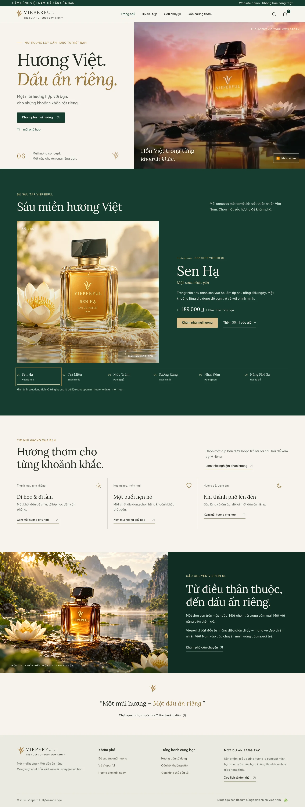
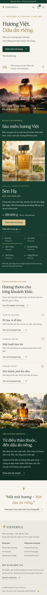
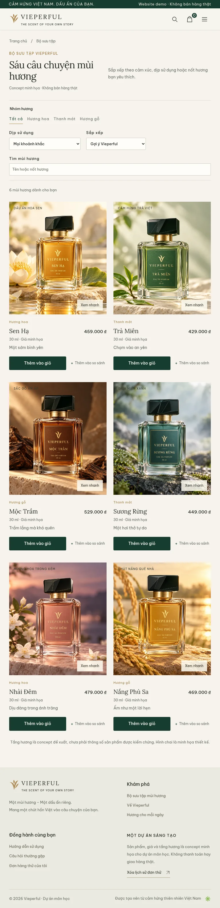
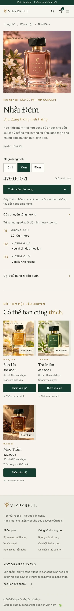

# Bố cục Vieperful — hướng dẫn chỉnh sửa

Bản thiết kế dùng tông kem, xanh rừng, nâu và vàng hổ phách. Nội dung chính luôn hiện kể cả khi người xem giảm chuyển động; trang chủ đưa người xem từ câu chuyện thương hiệu đến chọn mùi, dịp dùng và sản phẩm.

Website công khai: [vieperful.netlify.app](https://vieperful.netlify.app/).

## Xem giao diện

Các ảnh dưới đây được chụp từ bản chạy trong Chromium. Chọn ảnh để mở kích thước đầy đủ.

### Trang chủ — máy tính

### Trang chủ — điện thoại

### Bộ sưu tập — máy tính bảng

### Sản phẩm — điện thoại

## Thứ tự nội dung

| Khu vực | Mục đích | Nơi sửa trong `js/app.js` |
| --- | --- | --- |
| Phần mở đầu | Giới thiệu thương hiệu; vào bộ sưu tập hoặc mở trắc nghiệm | `home()` |
| Sáu mùi hương | Xem ảnh và thông tin từng mùi, mở chi tiết hoặc thêm 30 ml | `scentExperience()` |
| Chọn theo dịp | Mở danh mục với dịp dùng được lọc sẵn | `occasionSection()` |
| Câu chuyện | Hình ảnh và câu chuyện Vieperful | `brandStorySection()` |
| Hướng dẫn và chân trang | FAQ, bảo quản và thông tin demo | `home()` và `index.html` |

`home()` gọi các phần theo thứ tự. Dữ liệu tên, ảnh, nhóm hương, mô tả và giá nằm ở `js/products.js`; các lựa chọn trong cảnh sáu mùi lấy từ cùng dữ liệu này. Đổi dữ liệu ở một nơi sẽ cập nhật cả danh mục, xem nhanh, trắc nghiệm và cảnh chọn mùi.

## Hành trình chọn mua

1. **Tìm mùi:** trắc nghiệm hỏi dịp sử dụng, nhóm hương và ngân sách; kết quả xếp hạng tối đa hai mùi từ dữ liệu concept và nêu lý do.
2. **Chọn sản phẩm:** danh mục lọc theo nhóm hương/dịp, tìm kiếm và sắp xếp; có thể xem nhanh với dung tích và giá cập nhật, chọn đúng hai mùi để so sánh, hoặc mở trang chi tiết.
3. **Thử đặt hàng:** chọn dung tích, số lượng và điền biểu mẫu minh họa. Đơn lưu trong trình duyệt hiện tại; không thu tiền và không tạo yêu cầu giao hàng.

Giỏ hàng vẫn dùng chung dữ liệu và logic trong `js/store.js`. Kích thước giỏ và lịch sử đơn được lưu ở localStorage của trình duyệt.

## Chỉnh cỡ chữ, màu và khoảng cách

Các biến màu và cỡ chữ cơ bản ở đầu `css/style.css`. Bố cục được tinh chỉnh trong `css/layout.css`, file này được nạp sau `style.css`.

| Cần chỉnh | Selector |
| --- | --- |
| Tỷ lệ chữ và video phần mở đầu | `.hero` |
| Khối sáu mùi và các tab | `.scent-experience`, `.scent-feature`, `.scent-tab` |
| Cảnh ảnh và lớp chuyển động | `.scent-scene`, `.scent-scene img` |
| Chọn theo dịp và câu chuyện | `.occasion-section`, `.story-band` |
| Thẻ sản phẩm và số cột | `.product-card`, `.product-grid` |
| Bộ lọc danh mục | `.filters`, `.filter-chips` |
| Hộp xem nhanh / so sánh / trắc nghiệm | `.wide-dialog`, `.quick-view-dialog`, `.quiz-dialog` |
| Giỏ và thanh toán | `.drawer`, `.checkout-layout`, `.order-review` |
| Kích thước điện thoại | `@media (max-width: 760px)` và các mốc nhỏ hơn |

Màn hình rộng dùng ba cột sản phẩm, tablet 768 px và điện thoại dùng hai cột, màn hình dưới 360 px dùng một cột. Video chỉ tự phát ở màn hình rộng khi chuyển động không bị giảm; có nút phát/tạm dừng và poster ảnh. Cảnh sáu mùi nghiêng nhẹ theo con trỏ trên máy hỗ trợ hover. Hiệu ứng này không phải mô hình chai xoay 360°. Điện thoại và `prefers-reduced-motion` bỏ qua chuyển động.

## Thay ảnh và video

Ảnh concept hiện tại nằm trong `assets/`: sáu ảnh WebP sản phẩm vuông 1254 × 1254 và `vieperful-story.webp` 1672 × 941 cho câu chuyện thương hiệu. Đổi trường `image` theo sản phẩm trong `js/products.js`; thay ảnh câu chuyện trong `brandStorySection()` của `js/app.js`. Chữ dung tích in trong ảnh là nội dung concept, không tự đổi khi người dùng chọn dung tích.

Video bản gốc `assets/vieperful-film.mp4` được giữ lại. Trang dùng bản HD đã upscale `assets/vieperful-film-hd.mp4` và ảnh dự phòng `assets/film-poster-hd.jpg`. Upscale cùng làm nét có thể khiến khung hình trông rõ hơn trên màn hình lớn, nhưng không thể khôi phục chi tiết không có trong bản gốc. Đổi nguồn và poster trong `home()`.

## Phạm vi demo

Tên, giá, dung tích, tầng hương và lý do gợi ý là dữ liệu minh họa cho dự án môn học. Website không có backend, tài khoản, thanh toán, tồn kho, email xác nhận hoặc dịch vụ giao hàng. Không đưa đánh giá khách hàng hoặc cam kết thương mại như dữ kiện thật. Chỉ nhập thông tin giả khi thử biểu mẫu. Xóa giỏ và đơn thử qua các nút tương ứng; dữ liệu không đồng bộ sang trình duyệt hoặc thiết bị khác.

## Kiểm thử

Chạy `npm run check` và `npm test`. Bộ kiểm thử Chromium bao gồm desktop, tablet 768 px, điện thoại 390 px và 320 px, menu/bàn phím, giảm chuyển động, video dự phòng, bộ lọc không có kết quả, dung tích/giá, tăng giảm và xóa giỏ, tải lại, đặt đơn thử, lưu lịch sử và lỗi lưu trữ.

Lần xác minh gần nhất: **25/25 nhóm kiểm thử đạt** và `npm run check` đạt. Ảnh chụp dùng trong tài liệu nằm ở `docs/previews/`; ảnh chạy thử đầy đủ nằm trong `test-results/` và không được đưa vào Git.
