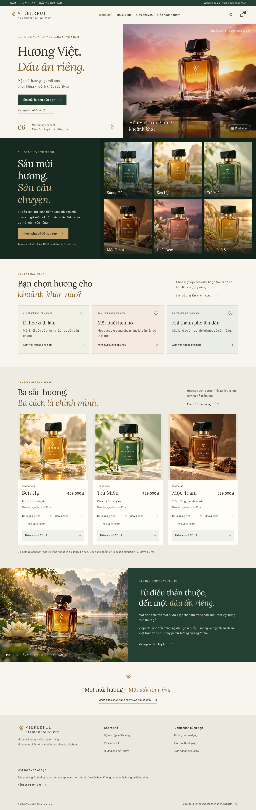
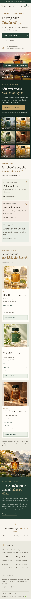
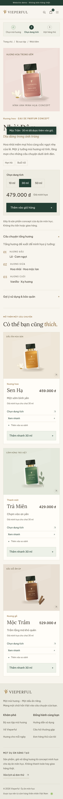

# Bố cục Vieperful — hướng dẫn chỉnh sửa

Bản này tập trung vào **chữ dễ đọc, các khu vực rõ ràng và biết bước tiếp theo cần làm gì**. Hình chai, logo, video và dữ liệu sản phẩm được giữ lại.

## Xem giao diện

Các ảnh dưới đây là ảnh chụp website chạy thực tế. Bấm vào ảnh trên GitHub để xem kích thước đầy đủ; đây không phải liên kết website đã triển khai.

### Trang chủ — máy tính



### Trang chủ — điện thoại



### Trang sản phẩm — điện thoại



## Thứ tự nội dung

| Khu vực | Người xem cần hiểu hoặc làm gì? | Nơi sửa nội dung trong `js/app.js` |
| --- | --- | --- |
| Phần mở đầu | Vieperful là gì; bắt đầu trắc nghiệm chọn hương hoặc xem bộ sưu tập | `home()` |
| 01 — Bộ sưu tập ảnh | Sáu ảnh WebP có liên kết đến từng sản phẩm | `productImageFeatureSection()` |
| 02 — Chọn hoàn cảnh | Chọn dịp dùng hoặc mở trắc nghiệm ba câu hỏi | `occasionSection()` |
| 03 — Sản phẩm nổi bật | Xem nhanh, so sánh, chọn dung tích hoặc thêm nhanh 30 ml | `featuredSection()` và `productCard()` |
| 04 — Câu chuyện | Đọc về cảm hứng thương hiệu | `brandStorySection()` |
| Hướng dẫn và chân trang | Tìm hướng dẫn sử dụng, FAQ, đơn hàng thử | `home()` và `index.html` |

`home()` gọi từng phần theo thứ tự; có thể di chuyển lời gọi `${productImageFeatureSection()}`, `${occasionSection()}`, `${featuredSection()}` và `${brandStorySection()}` để sắp xếp lại. Không cần sửa logic giỏ hàng.

## Hành trình chọn mua

1. **Chọn mùi hương:** trắc nghiệm ghi nhận dịp, nhóm hương và ngân sách để xếp hạng 1–2 gợi ý từ dữ liệu concept. Các thẻ dịp vẫn dẫn đến danh mục lọc.
2. **Xem/chọn sản phẩm:** “Xem nhanh” cập nhật giá theo dung tích rồi thêm giỏ; có thể so sánh tối đa ba lựa chọn. Trang chi tiết vẫn hỗ trợ chọn dung tích.
3. **Đặt hàng thử:** từ giỏ hàng sang biểu mẫu có phần xem lại đơn. Đây vẫn là mô phỏng, không thu tiền thật.

Thanh 3 bước ở danh mục, chi tiết và trang đặt hàng được tạo bởi `shoppingSteps()`. Bước hiện tại được đánh dấu bằng nền xanh đậm và thuộc tính `aria-current="step"`.

“Thêm nhanh 30 ml” trên thẻ sản phẩm là lối tắt có ghi rõ dung tích. Xem nhanh và trang chi tiết đều hỗ trợ 10, 30 hoặc 50 ml.

## Đổi cỡ chữ

Các biến ở đầu `css/style.css`:

```css
--text-body: 16px;  /* Nội dung chính */
--text-small: 14px; /* Chú thích, liên kết phụ */
--text-label: 12px; /* Nhãn ngắn, số bước */
--text-lead: 18px;  /* Đoạn mở đầu, giá trên thẻ */
```

Tiêu đề dùng kích thước riêng theo thiết bị. Một số nhãn trang trí dùng 11 px; đoạn mô tả và các nút chính không giảm xuống cỡ chữ nhỏ này trên điện thoại.

Muốn nội dung lớn hơn nữa, có thể đổi `--text-body` thành `17px`. Sau đó kiểm tra lại trên điện thoại để đảm bảo dòng chữ và nút không tràn ngang.

## Chỉnh khoảng cách và bố cục

`css/layout.css` được nạp **sau** `css/style.css`, nên là nơi ưu tiên chỉnh bố cục hiện tại. File chia thành các phần có chú thích tiếng Việt.

| Cần chỉnh | Selector |
| --- | --- |
| Tỷ lệ chữ và video phần mở đầu | `.hero` |
| Khoảng cách trên/dưới mỗi phần | `.section` |
| Khu vực chọn hoàn cảnh | `.occasion-grid`, `.occasion-card` |
| Thư viện ảnh sản phẩm | `.product-gallery-feature`, `.product-gallery`, `.product-gallery-tile` |
| Hộp chọn / xem nhanh / so sánh | `.quiz-dialog`, `.quick-view-dialog`, `.wide-dialog` |
| Nền khu vực sản phẩm | `.featured-section` |
| Số cột sản phẩm | `.product-grid` |
| Khung, khoảng đệm thẻ | `.product-card`, `.product-card-body` |
| Giá và tên sản phẩm | `.product-title-row` |
| Thanh 3 bước | `.shopping-steps` |
| Khối chọn dung tích | `#product-form` |
| Bố cục điện thoại | `@media (max-width: 600px)` |

Máy tính dùng 3 cột sản phẩm, máy tính bảng dùng 2 cột, điện thoại dùng 1 cột. Cả 3 sản phẩm nổi bật đều hiện trên điện thoại, giúp giữ cỡ chữ 16 px mà không ép thông tin vào thẻ quá hẹp.

## Sau khi chỉnh

Chạy `npm run check` và `npm test`. Bản hiện tại đạt 23/23 nhóm kiểm thử Chromium; `npm run check` cũng đạt. Đã kiểm tra tràn ngang ở 320 và 390 px, focus bàn phím, reduced motion, video fallback, bộ lọc, dung tích, giỏ và đặt thử.

Ảnh trong `docs/previews/` là ảnh bàn giao. Khi thay đổi thiết kế tiếp, cần chụp lại nếu muốn ảnh phản ánh đúng website mới.
